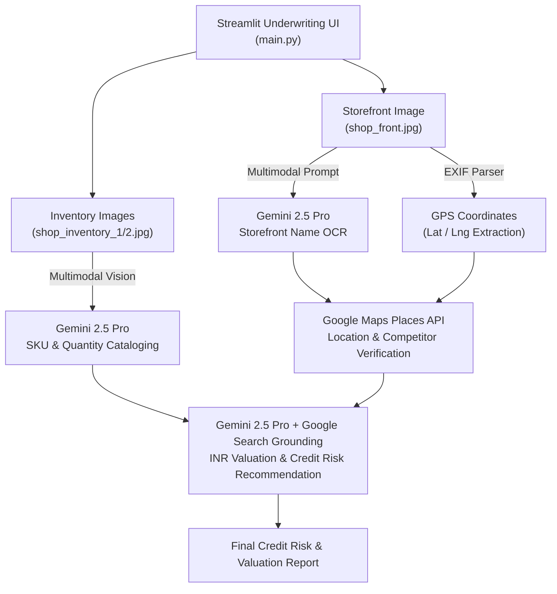

# 🏦 AI Demo Loan — Multimodal SMB Loan Underwriting & Credit Risk Engine


**AI Demo Loan** is an AI-powered financial underwriting workbench built with **Streamlit**, **Vertex AI (`gemini-2.5-pro`)**, **Google Search Grounding**, and the **Google Maps Places API**. It assists commercial lenders in evaluating the creditworthiness of Small and Medium Businesses (SMBs) using field photographs of their physical storefront and stock inventory.

---

## 📐 System Architecture



---

## ✨ Key Capabilities

1. **Automated Storefront OCR**: Extracts the merchant's business name directly from storefront signage using `gemini-2.5-pro`.
2. **EXIF Geolocation & Address Verification**: Parses GPS DMS coordinates from photo EXIF metadata and queries the Google Maps Places API (`places_nearby`) to validate the store's existence, ratings, and local competition within a 500m radius.
3. **Granular Inventory Recognition**: Analyzes multi-angle shelf photographs to produce a structured CSV table of brands, goods descriptions, and item counts.
4. **Grounded INR Valuation & Credit Decisioning**: Uses **Google Search Grounding** to estimate unit prices in Indian Rupees (INR), compute total inventory collateral value, and generate a credit risk recommendation.

---

## 🛠️ Tech Stack

| Component | Technology | Role |
| :--- | :--- | :--- |
| **Frontend UI** | Streamlit | Interactive underwriting dashboard |
| **Multimodal LLM** | Vertex AI `gemini-2.5-pro` | Storefront OCR, inventory counting, and risk appraisal |
| **Search Grounding** | Vertex AI Google Search Retrieval | Real-time market price lookup in INR |
| **Geospatial API** | Google Maps Places API (`googlemaps`) | Merchant verification and competitor mapping |
| **Secrets Management** | Google Cloud Secret Manager / `.env` | Secure storage for `GoogleMapsAPIKey` |
| **Image Metadata** | `exif` | GPS latitude/longitude and capture timestamp extraction |

---

## 📁 Project Structure

```text
smb-loan-visual-underwriter/
├── main.py                    # Primary Streamlit entry point
├── feature_shop_property.py   # Underwriting workflow (OCR, Maps lookup, inventory valuation)
├── utils.py                   # Vertex AI, Secret Manager, Google Maps, and EXIF helper utilities
├── shop_front.jpg             # Sample storefront image with embedded EXIF GPS metadata
├── shop_inventory_1.jpg       # Sample merchant inventory photo 1
├── shop_inventory_2.jpg       # Sample merchant inventory photo 2
├── .env.example               # Environment variable template
├── requirements.txt           # Python dependencies
└── README.md                  # Project documentation
```

---

## ⚙️ Environment Variables

| Variable | Required | Default | Description |
| :--- | :---: | :---: | :--- |
| `GCP_PROJECT_ID` | Yes | — | Google Cloud Project ID with Vertex AI enabled |
| `GCP_LOCATION` | No | `us-central1` | Vertex AI region |
| `GEMINI_MODEL` | No | `gemini-2.5-pro` | Gemini model identifier |
| `GOOGLE_MAPS_API_KEY` | Yes* | — | Google Maps Places API key (*falls back to Secret Manager `GoogleMapsAPIKey` if unset) |

---

## 🚀 Quickstart

### 1. Clone & Install Dependencies

```bash
git clone https://github.com/shubhamv3129/smb-loan-visual-underwriter.git
   cd smb-loan-visual-underwriter
python3 -m venv .venv
source .venv/bin/activate
pip install -r requirements.txt
```

### 2. Configure Credentials

```bash
cp .env.example .env
# Edit .env with your GCP_PROJECT_ID and GOOGLE_MAPS_API_KEY
gcloud auth application-default login
```

### 3. Launch the Application

```bash
streamlit run main.py
```

Open `http://localhost:8501` in your browser and click **Generate Insights** to execute the full underwriting pipeline.
